# Polyend Tracker CE — New Features User Manual (`Original Tracker / MK66`)

Welcome to the complete user manual for **Polyend Tracker Community Edition (CE)** targeting the **Original Polyend Tracker (`MK66`)**.

This guide documents every new synthesis, DSP, sequencing, storage, and interface feature added in Community Edition, accompanied by `800×480` Tracker SVG screen mockups ([regenerable script](generate_mockups.py)), exact screen-button mappings, parameter tables, and Original Tracker hardware workflows.

> **⚠️ Project Compatibility Notice (`.mtp` Version 6):**
> Saving a project in Polyend Tracker CE upgrades pattern files (`.mtp`) to **Version 6** to store dedicated per-step **Micro-move (`m`)** and **Volume (`V`)** values alongside **`Fx1`** and **`Fx2`**.
> Existing projects from official/older firmwares load automatically, but once saved in CE they cannot be opened on older official firmware. Back up your `/Projects/` folder or use **`Save As`** before migrating important sets.

---

## Table of Contents

1. [Original Tracker Hardware & UI Conventions](#1-original-tracker-hardware--ui-conventions)
2. [Synth Play Mode (`Sample Playback > Play Mode: Synth`)](#2-synth-play-mode-sample-playback--play-mode-synth)
3. [Granular `Cloud` Mode & `Slice / Beat Slice` `Play Thru`](#3-granular-cloud-mode--slice--beat-slice-play-thru)
4. [256-Slot Wavetable Envelopes (`WT Env`) & `WT LFO` (`Instrument Automation 2/2`)](#4-256-slot-wavetable-envelopes-wt-env--wt-lfo-instrument-automation-22)
5. [Contextual `Instrument Automation 2/2` (Up to 9 Simultaneous Generators)](#5-contextual-instrument-automation-22-up-to-9-simultaneous-generators)
6. [Pattern Editor: `[m | V]` Columns, New Step FX (`w`, `y`, `z`), `Chance` Conditions & 68 Chords](#6-pattern-editor-m--v-columns-new-step-fx-w-y-z-chance-conditions--68-chords)
7. [Master Bus `Drive+` Saturation, Delay Freeze (`Frz`), Tape Slew & SVF Filter Headroom](#7-master-bus-drive-saturation-delay-freeze-frz-tape-slew--svf-filter-headroom)
8. [Hybrid SD Card Sample Streaming (`[S]`) & Sample Loader Enhancements](#8-hybrid-sd-card-sample-streaming-s--sample-loader-enhancements)
9. [Modular `.ptfx` Sample Editor Effects & `.ptp` Presets](#9-modular-ptfx-sample-editor-effects--ptp-presets)
10. [Global File Browser (`Explorer` + `Details` Inspector)](#10-global-file-browser-explorer--details-inspector)
11. [Custom Themes, Custom Fonts, Image Viewer & Performance Mode MIDI Toggle](#11-custom-themes-custom-fonts-image-viewer--performance-mode-midi-toggle)
12. [Under-the-Hood Engine, Export & MIDI Upgrades](#12-under-the-hood-engine-export--midi-upgrades)

---

## 1. Original Tracker Hardware & UI Conventions

Community Edition preserves the Original Polyend Tracker's workflow, dedicated panel keys, **48 RGB pads**, **rotary Jog Wheel**, **arrow keys**, and **8 bottom screen buttons (`[1]`–`[8]`)** below the `800×480` display:

* **`[1]`–`[8]`** correspond to the 8 physical buttons directly beneath the bottom row of screen labels.
* **`Jog Wheel` / `Up/Down`** adjusts the currently framed parameter (highlighted in red) or scrolls the active list.
* **`Shift + Control`** accesses secondary actions (e.g., `Shift + Wheel` for `Warp Y` or `Mod` target selection, `Shift + [1]` in Sample Loader for `Add to Empty Slot`, `Shift + [1..8]` in Performance Mode to Mute/Unmute tracks).

---

## 2. Synth Play Mode (`Sample Playback > Play Mode: Synth`)

Community Edition brings a real-time dual-oscillator synthesizer directly into the Original Tracker (`MK66`) inside **`Sample Playback`** without needing external `.psyn` plugins.

### Highlights

* **Zero Sample Required**: Select any empty instrument slot (`0..47`) or any existing sample slot, open **`Sample Playback`**, and switch **`Play Mode`** (`[7]` / `[8]`) to **`Synth`**. You can trigger and sequence notes on empty slots immediately.
* **Persistent Inside `.pti` & `.mt` Files**: All Synth parameters are overlaid cleanly inside `strInstrument` (`slices[48]`, `sizeof(strInstrument) == 372`), saving and loading seamlessly with projects and `.pti` instruments.
* **Live Real-Time Oscilloscope**: The `600 px` waveform display renders a live **2-cycle oscilloscope preview** of the active synthesis engine, oscillator blend, detune, pulse width / DCW, and wavefolder contour as you edit.
* **Fast Fixed-Point PolyBLEP Engine**: Runs natively on the MK66 180 MHz Cortex-M4 inside the standard `AudioVoice` chain (meaning per-voice **SVF Filter**, **Overdrive**, **Bitcrusher**, **Panning**, **Delay/Reverb Sends**, **Step FX**, and all **Envelopes / LFOs / WT Env / WT LFO** apply to `Synth` instruments automatically).

### Mockup 1A — `Sample Playback` (`Synth` Mode, Page 1 `•◦`)

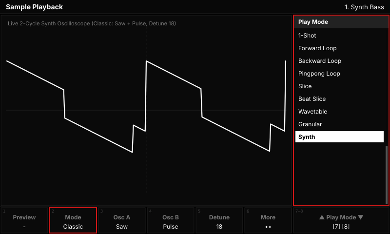

### Mockup 1B — `Sample Playback` (`Synth` Mode, Page 2 `◦•`)

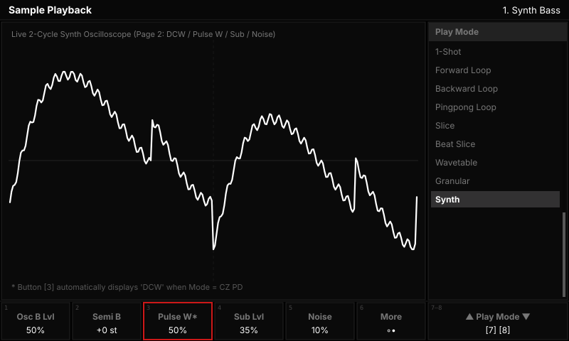

### Synthesis Engines (`[2] Mode` on Page 1)

| Mode | Oscillator Architecture & Sonic Character | `Detune` (`[5]`) Behavior |
| :--- | :--- | :--- |
| **`Classic`** | Dual PolyBLEP oscillators (`Osc A` + `Osc B`) mixed with sub-oscillator & noise. | Detunes `Osc B` symmetrically against `Osc A`. |
| **`Sync`** | Hard-sync (`Osc A` resets `Osc B` phase) for classic cutting lead sweeps. | Controls slave pitch / sync sweep ratio. |
| **`CSaw`** | Supersaw-style stacked saw voices (`Osc A`) + `Osc B`. | Widens unison detune spread. |
| **`Swarm`** | Multi-oscillator detuned swarm for thick pads and hoovers. | Adjusts swarm pitch spread. |
| **`FM`** | 2-operator Phase Modulation (`Osc B` modulates `Osc A`; `"Triangle"` selects a pure Sine wave). | Controls FM modulation index / feedback character. |
| **`Ring`** | Ring modulation (`Osc A × Osc B`) for metallic bells, clangs, and sci-fi basses. | Offsets carrier/modulator detune ratio. |
| **`Fold`** | Multi-stage West-Coast Wavefolder driven by `Osc A` + `Osc B`. | Drives wavefolder gain / harmonic fold depth. |
| **`CZ PD`** | Casio CZ-style Phase Distortion using 8 dedicated CZ waves (`Saw`, `Square`, `Pulse`, `DblSine`, `SawPls`, `ResSaw`, `ResTri`, `ResTrp`). | Detunes dual PD phase distortion lines; Page 2 `[3]` becomes **`DCW`** (timbre distortion amount). |

### Synth Parameters & Real-Time Modulation

* **Oscillator Shapes (`[3] Osc A`, `[4] Osc B`)**:
  * Standard modes (`Classic`–`Fold`): **`Saw`**, **`Pulse`**, **`Triangle`** (pure parabolic **`Sine`** when in `FM` mode).
  * `CZ PD` mode: **`Saw`**, **`Square`**, **`Pulse`**, **`DblSine`**, **`SawPls`**, **`ResSaw`**, **`ResTri`**, **`ResTrp`**.
* **Page 2 Parameters (`[6] More` toggles `•◦` ↔ `◦•`)**:
  * **`[1] Osc B Lvl`** (`0%`–`100%`), **`[2] Semi B`** (`-24 st` to `+24 st`), **`[3] Pulse W` / `DCW`** (`0%`–`100%`), **`[4] Sub Lvl`** (`0%`–`100%` square sub-octave), **`[5] Noise`** (`0%`–`100%` white noise).
* **Modulation Routing**:
  * Every oscillator parameter appears directly in `Instrument Automation 2/2` with mode-accurate labels (**`DCW A`** / **`DCW B`** in `CZ PD`, **`Fold Drive`** / **`Fold Sym`** in `Fold`, **`FM Index`** / **`FM Feedback`** in `FM`, **`CSaw Notch`** in `CSaw`, **`Swarm Sprd`** in `Swarm`, plus **`Osc B Pitch`**, **`Detune`**, **`Osc B Level`**, **`Sub Level`**, **`Noise Level`**, and master **`Pitch`**) — no manual slot routing or `Mod 1`/`Mod 2` indirection required.

---

## 3. Granular `Cloud` Mode & `Slice / Beat Slice` `Play Thru`

### Granular `Cloud` Loop Mode & Extended 1000 ms Length

In **`Sample Playback`** with **`Play Mode: Granular`**, Community Edition adds a polyphonic multi-grain **`Cloud`** mode alongside `Forward`, `Backward`, and `PingPong`, and extends maximum **`Length`** from `100.0 ms` up to **`1000.0 ms`** (`1.0 s`).

#### Mockup 2A — `Sample Playback` (`Granular` + `Cloud`)

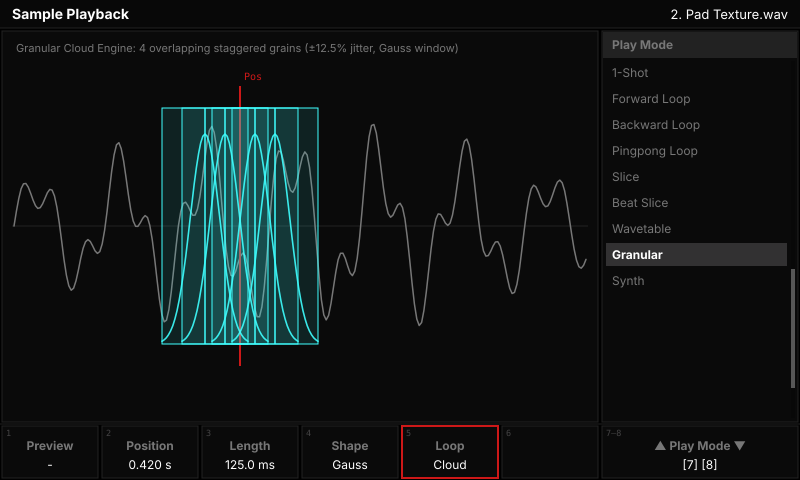

* **`[2] Position`** (`0.000 s`…): Anchor position inside the sample.
* **`[3] Length`** (`1.0 ms`–`1000.0 ms`): Grain window duration (`1.0–100.0 ms` fine resolution + `100.0–1000.0 ms` long pads). Can also be automated in `Instrument Automation 2/2` or per-step via **`z - Granular Length`**.
* **`[4] Shape`**: Grain envelope window (`Square`, `Triangle`, `Gauss`).
* **`[5] Loop`**: `Forward`, `Backward`, `PingPong`, **`Cloud`**. **`Cloud`** spawns up to **4 overlapping staggered grains** with randomized forward/reverse directions, `±12.5%` position jitter around `Position`, and `0.707×` gain compensation to prevent clipping.

### `Slice` & `Beat Slice` `Play Thru` Mode

On Page 2 (`[6] More`) of **`Slice`** and **`Beat Slice`** modes, **`[4] Play Thru`** controls what happens after a slice reaches its end marker.

#### Mockup 2B — `Sample Playback` (`Slice` / `Beat Slice`, Page 2 `◦•`)

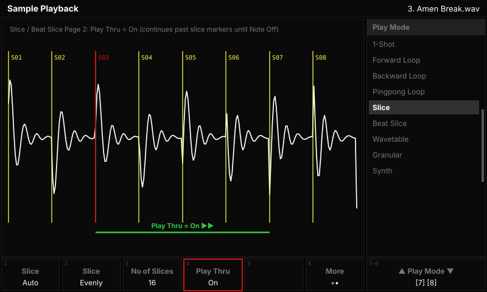

* **`[4] Play Thru` = `Off`** *(Original behavior)*: Playback stops cleanly when reaching the next slice marker.
* **`[4] Play Thru` = `On`**: Triggering any slice starts from that marker and plays straight through subsequent slices until `Note Off` / `CUT` / `FAD` or the end of the sample.

---

## 4. 256-Slot Wavetable Envelopes (`WT Env`) & `WT LFO` (`Instrument Automation 2/2`)

Standard `Envelope` (ADSR) and `LFO` automation types are joined by **`WT Env`** (one-shot / sustain wavetable envelope) and **`WT LFO`** (free/sync wavetable LFO), powered by a shared **256-slot single-cycle shape bank** (`128 Factory` + `128 User`).

### Mockup 3A — `Instrument Automation 2/2` (`WT Env`)

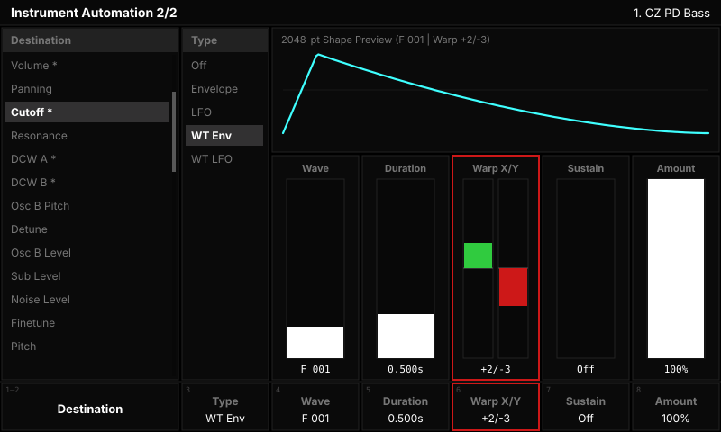

### Mockup 3B — `Instrument Automation 2/2` (`WT LFO`)

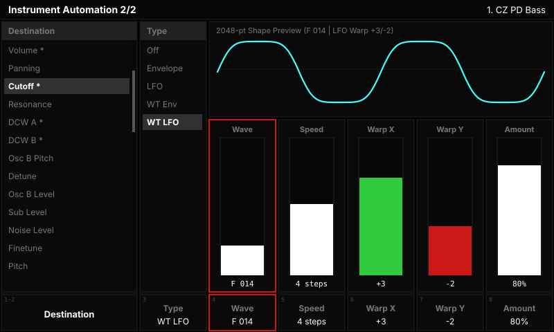

### Controls & Wavetable Bank Details

* **256 Wavetable Slots**:
  * **`F 001`–`F 128` (Factory)**: Classic ADSR mimics, exponential plucks, multi-bounces, stepped rhythms, vocal formants, and fractal gates.
  * **`U 001`–`U 128` (User)**: Custom single-cycle contours populated from SD card `.wav` files in `/Envelopes/*.wav` (128 samples per cycle) or automatically registered when importing wavetables in **`Sample Playback > Wavetable`**.
* **Dual-Axis `Warp X / Warp Y` Shaping**:
  * In **`WT Env`**, **`[6] Warp X/Y`** uses a split bipolar bar (`-7..+7 / -7..+7`): turn **`Jog Wheel`** for **`Warp X`** (skew/time bend), hold **`Shift + Jog Wheel`** for **`Warp Y`** (curvature/contrast), and press **`Delete`** to reset both to `+0/+0`.
  * In **`WT LFO`**, **`[6] Warp X`** (`-7..+7`) and **`[7] Warp Y`** (`-7..+7`) have dedicated buttons.
* **Parameters**:
  * **`WT Env`**: `[4] Wave`, `[5] Duration` (`0.000s`–`20.000s`), `[6] Warp X/Y`, `[7] Sustain` (`Off`, `1%`–`99%` hold point in the wavetable cycle while note is held), `[8] Amount` (`0%`–`100%`).
  * **`WT LFO`**: `[4] Wave`, `[5] Speed` (`128 steps` down to `1/64 step`, or `1/6 step` on `Volume`), `[6] Warp X`, `[7] Warp Y`, `[8] Amount` (`0%`–`100%`).

---

## 5. Contextual `Instrument Automation 2/2` (Up to 9 Simultaneous Generators)

**`Instrument Automation 2/2`** presents a **single, context-aware `Destination` list (`[1–2]`)** adapted automatically to your instrument's active **`Play Mode`** and **`Synth` oscillator engine**, preserving the pure Original Tracker workflow: pick a destination, choose its **`[3] Type`** (`Off`, `Envelope`, `LFO`, `WT Env`, or `WT LFO`), and dial `[4]`–`[8]`.

### Mockup 4 — Contextual `Instrument Automation 2/2` (`CZ PD` Mode Example)

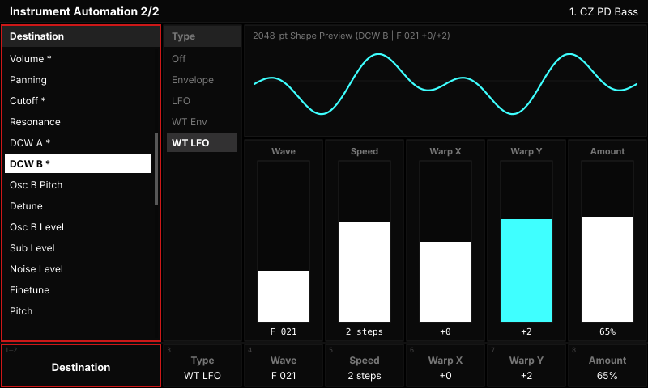

### How Contextual Destinations & Dynamic 9-Slot Pool Work

1. **Context-Filtered Destination Order**:
   * **Core**: `Volume`, `Panning`, `Cutoff`, `Resonance`
   * **Active `Play Mode`**:
     * **`Synth`**: **`Pulse Width`** (`CSaw Notch` in `CSaw`, `FM Index` in `FM`, `Fold Drive` in `Fold`, **`DCW A`** in `CZ PD`), **`Osc B PW`** (`Swarm Sprd` in `Swarm`, `FM Feedback` in `FM`, `Fold Sym` in `Fold`, **`DCW B`** in `CZ PD`), **`Osc B Pitch`** (`±24 st`), **`Detune`**, **`Osc B Level`**, **`Sub Level`**, **`Noise Level`**
     * **`Wavetable`**: **`WT Position`**
     * **`Granular`**: **`Granular Pos`**, **`Granular Len`**
     * **`Forward / Backward / Ping-Pong Loop`**: **`Loop Pos`** (clamped safely between `Loop Start` and `Loop End`)
   * **Global & Voice FX**: `Finetune`, **`Pitch`** (`±24 st`), **`Overdrive`**, **`Bit Depth`**, **`Delay Send`**, **`Reverb Send`**
2. **Active Marker (`*`) & `Delete` Reset**:
   * Any destination whose automation is active (`Type != Off`) displays an asterisk (**`Volume *`**, **`DCW A *`**, **`DCW B *`**, …).
   * Pressing **`Delete`** with **`[3] Type`** selected resets the highlighted destination back to **`Off`** and frees its generator slot.
3. **Transparent 9-Generator Dynamic Pool**:
   * Up to **9 destinations** can be automated simultaneously on one instrument (**5 dedicated core lanes**: `Volume`, `Panning`, `Cutoff`, `Finetune`, and active mode's primary param — `WT Position` / Timbre A / `Granular Len` + `Granular Pos` — **plus a 4-slot dynamic pool** shared across `Resonance`, `DCW B` / Timbre B, `Osc B Pitch`, `Detune`, `Osc B Level`, `Sub Level`, `Noise Level`, `Loop Pos`, `Pitch`, `Overdrive`, `Bit Depth`, `Delay Send`, `Reverb Send`).
   * If all dynamic pool slots are in use and you enable another pooled destination, `[1–2]` briefly notifies **`Pool Full (4/4)`** (`Pool Full (3/3)` in `Granular`; `Pool Full (1/1)` in `Slice`/`Beat Slice` where `slices[48]` markers occupy the extra overlay). Turn any unused pooled destination to `Off` to free a slot.

> **Compatibility:** All fixed and pooled modulators serialize transparently inside `sizeof(strInstrument) == 372` (`3×28`-byte `strExtraModSlot` overlay inside `slices[48]` + alignment padding metadata) for full `.pti` and `.mt` project persistence.

---

## 6. Pattern Editor: `[m | V]` Columns, New Step FX (`w`, `y`, `z`), `Chance` Conditions & 68 Chords

### Dedicated `[m | V]` Micro-move & Volume View

Each step in Pattern View (`Version 6 .mtp`) now stores dedicated **Micro-move (`m`)** (`0..100%`) and **Volume (`V`)** (`0..100`) values independently from **`Fx1`** and **`Fx2`**, leaving both FX columns free.

* **Toggle Shortcut**: While in **Pattern** view with the cursor on the **`Note`** column, press the physical **`[Note]`** button again to toggle columns between **`[Fx1 | Fx2]`** and **`[m | V]`**.
* Empty steps in `[m | V]` view display dimmed **`m--`** and **`V--`** markers so you always know which view is active.
* Full editing support in `[m | V]` view: `Jog Wheel`, `+/-`, Pad entry, `Delete`, `Copy` / `Paste`, `Invert`, `Undo` / `Redo`, **`Fill`** (`Constant`, `From-To`, `Random`, `Euclidean`), and **Live Recording** (`Record Microtiming` / `Record Velocity`).

#### Mockup 5A — `Pattern` Toggled to `[m | V]` View

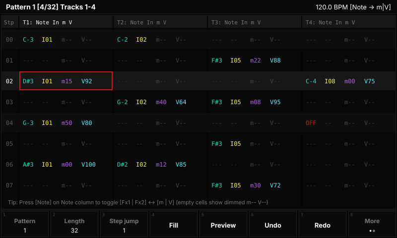

### Mockup 5B — Step FX Popup (`w`, `y`, `z`, Extended `C - Chance`, and 68 Chords)

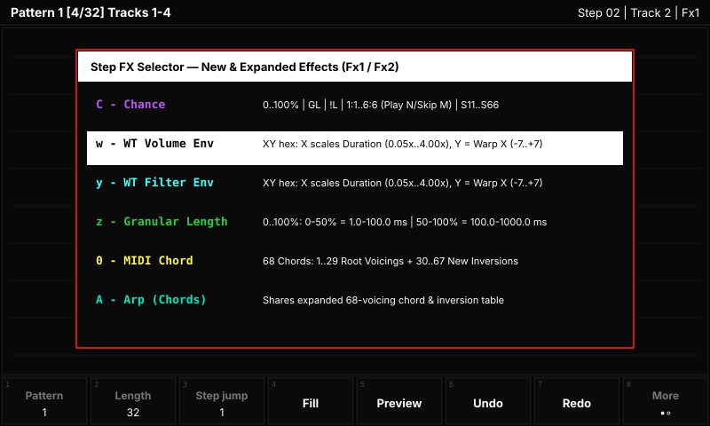

### New & Expanded Pattern Step FX Reference

* **`w - WT Volume Env` & `y - WT Filter Env`** (`00`–`FF` hex `XY`):
  * When **`Volume`** (`w`) or **`Cutoff`** (`y`) uses **`WT Env`**:
    * **Upper nibble `X` (`0..F`)**: Multiplies `WT Env` **`Duration`** (`0.05×` at `0`, `1.00×` neutral at `8`, up to `4.00×` at `F`).
    * **Lower nibble `Y` (`0..F`)**: Offsets `WT Env` **`Warp X`** (`-7` at `1`/`0`, `+0` neutral at `8`, up to `+7` at `F`).
  * When **`Volume`** / **`Cutoff`** uses standard ADSR **`Envelope`**: `X` scales **Attack** and `Y` scales **Decay/Release**.
* **`z - Granular Length`** (`0`–`100%`):
  * Non-linear curve: **`0–50%`** sweeps **`1.0 ms – 100.0 ms`** for tight percussive micro-grains; **`50–100%`** sweeps **`100.0 ms – 1000.0 ms`** for expansive clouds.
* **`C - Chance` Conditional Triggers**:
  * **`C  0`–`C100`**: Classic probability (`0–100%`).
  * **`C GL`** (*Group with Last*): Plays only if the previous conditional step evaluated on the same track **played**.
  * **`C !L`** (*Not Last*): Plays only if the previous conditional step evaluated on the same track was **skipped**.
  * **`C1:1`–`C6:6`** (*Play N / Skip M*): Plays for `N` consecutive pattern playthroughs, then skips for `M` playthroughs (`N, M ∈ 1..6`).
  * **`CS11`–`CS66`** (*Skip N / Play M*): Skips for `N` consecutive playthroughs, then plays for `M` playthroughs (`N, M ∈ 1..6`).
* **`0 - MIDI Chord` & `A - Arp` (Expanded to 68 Chords)**:
  * Expanded from 30 to **68 chord voicings** by adding **38 chord inversions** (`1..29` root voicings, `30..67` inversions across major, minor, seventh, diminished, suspended, and `m7b5` chords).

---

## 7. Master Bus `Drive+` Saturation, Delay Freeze (`Frz`), Tape Slew & SVF Filter Headroom

### Master Saturation `Drive+` (`Master 1/3`)

In **`Master 1/3`**, **`[6] Saturation`** now includes a fifth algorithm — **`Drive+`** — providing an asymmetrical, warm, tube-inspired overdrive stage alongside `Hard Clip`, `Soft Clip`, `Saturate`, and `Overdrive`.

#### Mockup 6A — `Master 1/3` (`Saturation: Drive+`)

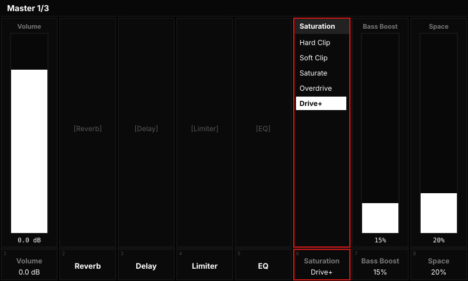

### Master Delay Freeze (`Frz`), Tape Slew & SVF Filter Headroom

#### Mockup 6B — `Master Delay` (`Feedback: Frz`)

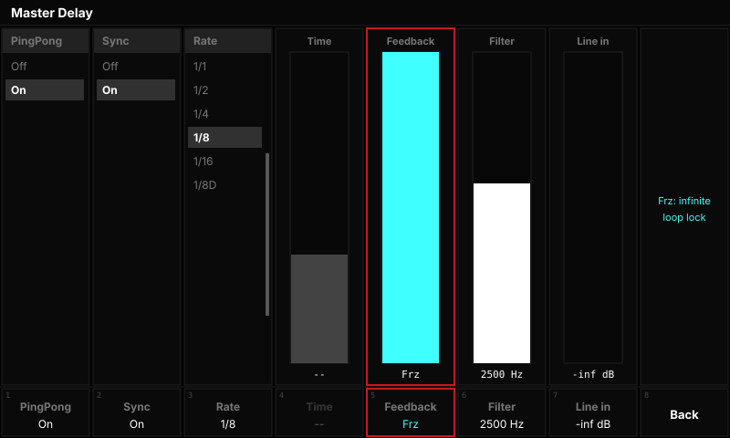

* **`[5] Feedback` = `Frz` (at `100`)**: Turning Feedback all the way to **`100`** engages **Delay Freeze (`Frz`)**. New audio input to the delay line is muted while the existing delay buffer recirculates indefinitely at unity gain — ideal for live ambient drones, stutter transitions, and glitch builds. Dialing below `100` resumes normal decay seamlessly.
* **Sub-Sample Tape Slewing**: Changing **`Time`** or **`Rate`** interpolates smoothly across Q8 sub-sample tap positions, producing authentic analog tape pitch-glide sweeps instead of zipper clicks.
* **Per-Voice SVF Headroom**: Every voice's State Variable Filter (`Lowpass` / `Bandpass` / `Highpass`) includes a **`+12 dBFS` soft-limiting knee** on the bandpass integrator, preventing harsh digital wraparound distortion at extreme resonance.

---

## 8. Hybrid SD Card Sample Streaming (`[S]`) & Sample Loader Enhancements

Long audio files (`>= 256 KB` by default when `Auto` is selected, or forced with `[S]`) can keep only their initial transient attack in SDRAM while streaming the rest of the waveform from the SD card in real time via `VoiceStreamManager`.

### Mockup 7 — `Sample Loader` (`[S]` Badges, `Mem:` / `Mode:` Selector & `Add to Empty Slot`)

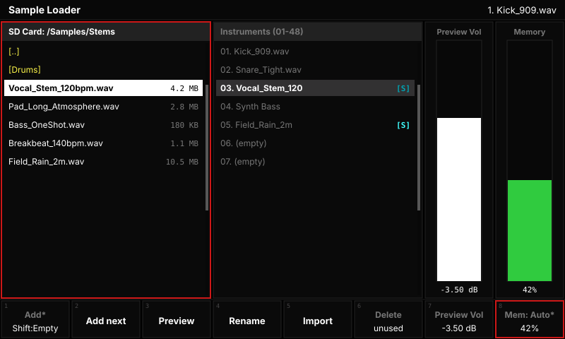

*(Button shortcuts: hold **`[Shift] + [1]`** in the SD Card pane for **`Add to Empty Slot`**; **`[8]`** cycles **`Mem: RAM` / `Mem: Auto` / `Mem: [S]`** on the SD Card pane, or toggles **`Mode: RAM` / `Mode: [S]`** on an existing instrument in the right pane.)*

### Sample Loader & Streaming Rules (`Original Tracker`)

* **RAM by Default (`Mem: RAM`)**: Newly loaded samples default to RAM unless you toggle **`[8]`** to **`Mem: Auto`** (streams samples `>= 256 KB`) or **`Mem: [S]`** (forces streaming on eligible files).
* **Per-Instrument Toggle (`Mode: RAM` / `Mode: [S]`)**: Highlight any loaded slot in the right-hand **`Instruments`** list and press **`[8]`** to convert that instrument between RAM-resident and `[S]` SD-streamed playback on the fly.
* **Streamable Play Modes on `MK66`**:
  * Streaming works in **`1-Shot`**, **`Forward Loop`**, **`Backward Loop`**, and **`Pingpong Loop`**.
  * **`Slice`**, **`Beat Slice`**, **`Wavetable`**, and **`Granular`** keep the full sample in RAM for zero-latency random access.
* **`Crop & Stream`**: On the partial sample crop screen, **`Import Stream`** imports a trimmed slice as an SD-streamed instrument.
* **`Shift + [1]` (`Add to Empty Slot`)**: Hold **`[Shift]`** while browsing `/Samples/` to jump straight to the next free instrument slot (`Add to Empty Slot` / `Next Slot`).
* **Transparent Sample Editing**: Opening a `[S]` streamed sample in **`Sample Editor`** automatically buffers it into SDRAM for editing and returns to streaming afterward (samples larger than available edit RAM should be pre-trimmed off-device).

---

## 9. Modular `.ptfx` Sample Editor Effects & `.ptp` Presets

Offline effects and generators in **`Sample Editor`** can now be loaded dynamically as hot-swappable `.ptfx` plugins from `/Effects/*.ptfx` on the SD card, with up to **12 parameters** across pages and persistent **`.ptp` user presets** in `/Effects/Presets/<PluginName>/*.ptp`.

### Mockup 8A — `Sample Editor` (`.ptfx` Parameter View, `More •◦`)

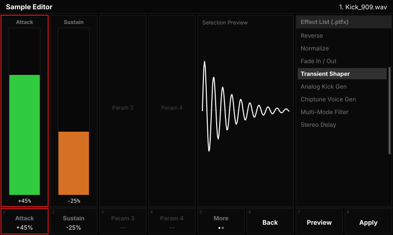

### Mockup 8B — `Sample Editor` (`.ptfx` Preset Management View, `More ◦•`)

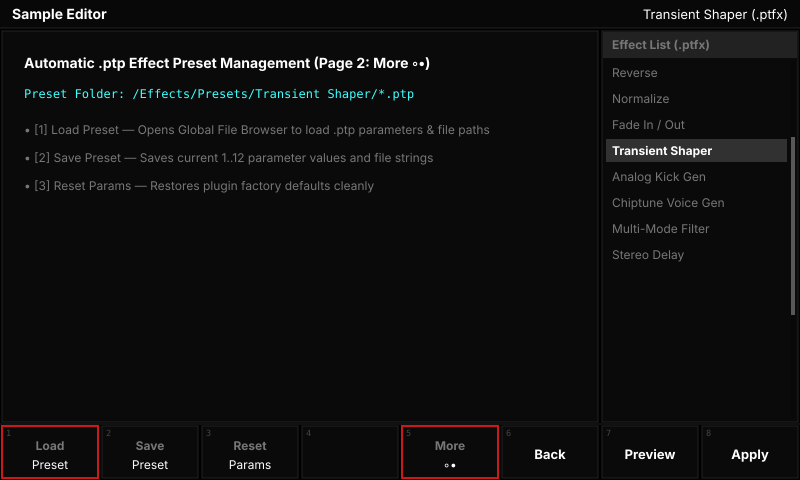

### Bundled `/Effects/*.ptfx` Plugins (`Original Tracker`)

* **Effects**: `Transient Shaper` (bipolar `Attack` `-100%..+100%`, `Sustain` `-100%..+100%`), `Multi-Mode Filter`, `Stereo Delay`, `Add Silence`, `Stereo to Mono`.
* **Generators**: `Analog Kick Gen`, `Chiptune Voice Gen`.

---

## 10. Global File Browser (`Explorer` + `Details` Inspector)

Single-level file pickers across the firmware are replaced by **`GlobalFileBrowser`**, providing full multi-folder directory navigation, file deletion, folder creation, inline metadata inspection, and live WAV auditioning.

### Mockup 9 — `Global File Browser`

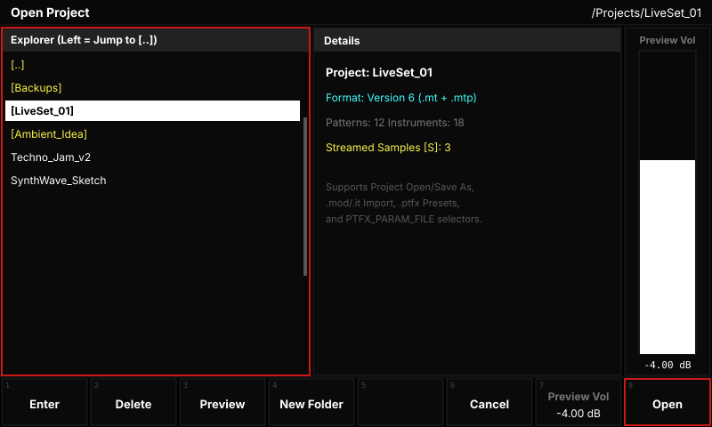

* Used uniformly by Project **`Open`** / **`Save As`**, **`.mod` / `.it` Import**, **`.ptfx` Presets** (`Load` / `Save`), and **`PTFX_PARAM_FILE` / `PTFX_PARAM_SAVE_FILE`** plugins.
* Press **`[Left]`** arrow inside **`Explorer`** at any time to jump immediately to `[..]` at the top of the list.

---

## 11. Custom Themes, Custom Fonts, Image Viewer & Performance Mode MIDI Toggle

### Custom Themes & Fonts (`Config > General`) and Image Viewer (`Config > Info`)

#### Mockup 10A — `Config` (`General` & `Info`)

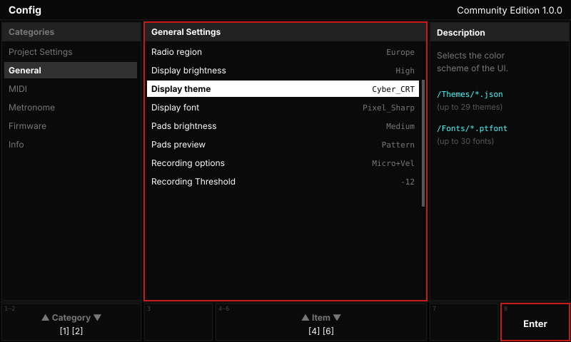

* **Custom Themes (`/Themes/*.json`)**: Up to 29 user JSON themes alongside `Original`, `Monochrome`, and `Anniversary`.
* **Custom Fonts (`/Fonts/*.ptfont`)**: Up to 30 user antialiased bitmap fonts alongside `Original` and `New`. Design both using the web [Tracker Theme & Font Editor](https://polyend.github.io/tracker-theme-editor/).
* **Image Viewer (`Config > Info`)**: Select **`Reference`**, **`Notes`**, or **`Custom`** (`800×390` baseline JPEGs named `1.jpg`–`48.jpg` in `/Images/<Folder>/`).

#### Mockup 10B — `Image Viewer` (`800×390` Viewport)

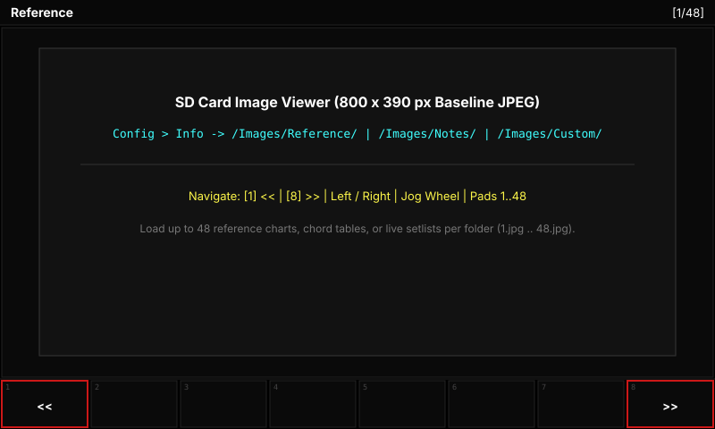

### Performance Mode MIDI Track Page (`[Perform]` Toggle)

Pressing the **`[Perform]`** hardware button while already in **Performance Mode** toggles the bottom 8 track controls **`[1]..[8]`** between **Sample Tracks `1–8`** and **MIDI Tracks `9–16`** (and press **`[Shift] + [1..8]`** to Mute/Unmute tracks on either page).

#### Mockup 10C — `Performance FX` (MIDI Tracks Page via `[Perform]`)

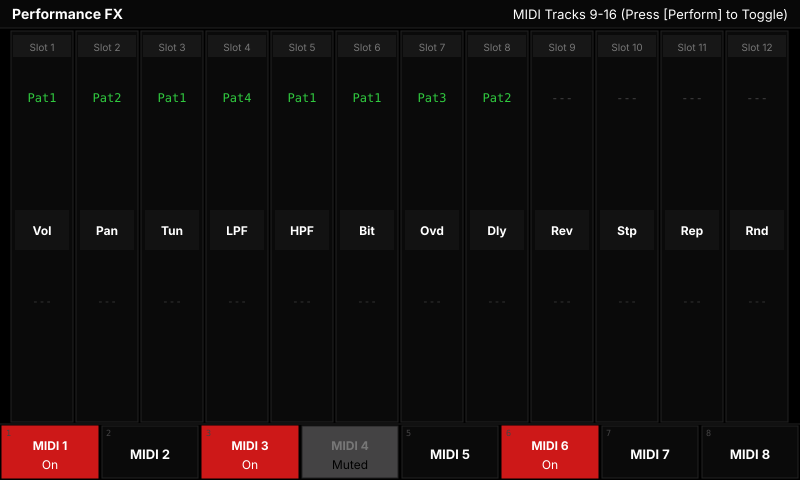

---

## 12. Under-the-Hood Engine, Export & MIDI Upgrades

* **Exact `44,100 Hz` Offline Audio Export & Click-Free Renders**: Eliminates sample-rate drift and trailing clicks/silence during stem and master `.wav` bounces and Sample Editor effects.
* **Copy-on-Write `/Workspace/instruments/` Project Saving & Loading**: Opening large projects streams directly without cloning every sample first; saving only rewrites edited/new `.wav` instruments, making pattern/synth edits save almost instantaneously.
* **MIDI Timing & USB Overhaul**: ~15× tighter MIDI Clock output precision, instant downbeat Step-1 external sync, `Continue` / `Song Position Pointer` support, Windows 11 USB MIDI fix, and calibrated `Clock Sync Correction`.
* **Live Recording Upgrades**: Tight overlapping double-notes on single-armed tracks are preserved cleanly, the first note after pre-roll sounds aloud, and **`Config > General > Recording Threshold`** catches slightly early first notes during count-in.
* **Beat-Slice Pad Guides During Live Recording**: Live recording (`Rec + Play`) illuminates beat-slice guide lights across the 48 pads just like step entry.
